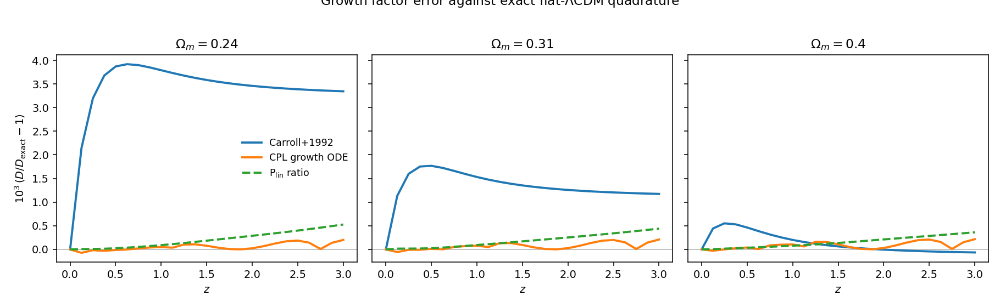
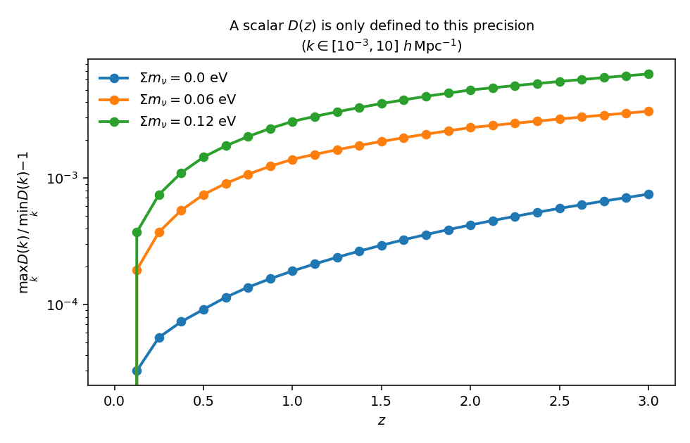
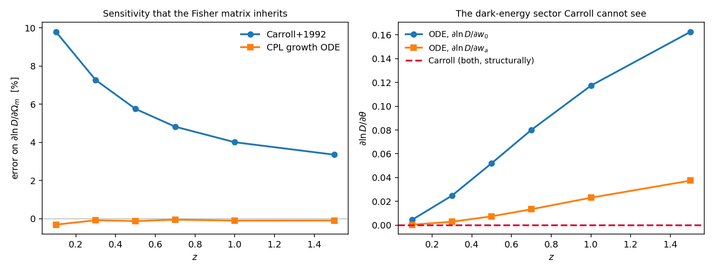
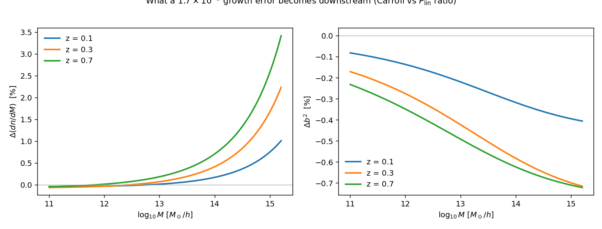
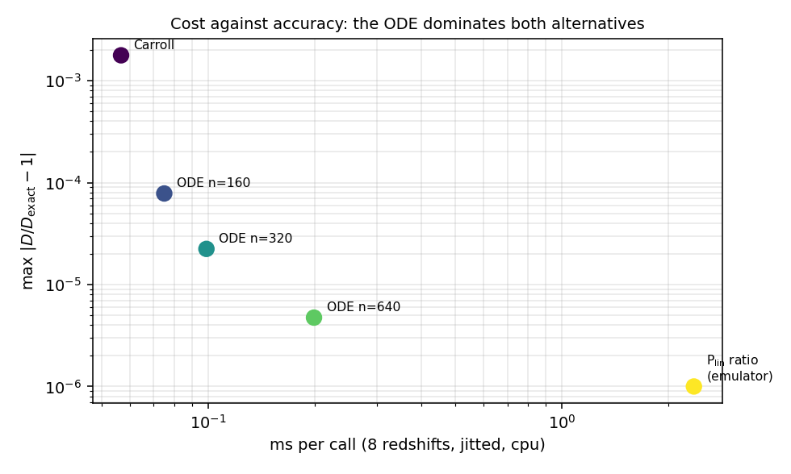

.. _growth_factor:

Growth factor: approximation versus inference
=============================================

The halo model needs the linear growth factor :math:`D(z)/D(0)` in two very
different places, and for a long time it got them from two different formulas
without ever checking that they agreed.
:meth:`~hod_mod.core.halo_mass_function.HaloMassFunction.sigma` evaluated the
:math:`P(k)` backend **at** :math:`z = 0` and multiplied by an analytic growth
factor, while the 2-halo term asked the *same backend* for
``pk_linear(k, z, theta)`` and received the backend's own, exact growth.  One
leg of the model therefore grew with a fitting formula and the other with a
Boltzmann solver — and the pipeline paid for both spectra.

Worse, *which* analytic formula ran was decided by dictionary-key membership:

.. code-block:: python

   if ("w0" in theta) or ("wa" in theta):
       return _growth_factor_cpl_jax(...)      # the growth ODE
   return _growth_factor_flat_jax(z, theta["Omega_m"])   # Carroll+1992

:meth:`~hod_mod.core.power_spectrum.LinearPowerSpectrum.default_cosmology`
ships ``w0``/``wa``, so it took the ODE.  No ``cosmology:`` block in ``configs/``
carries them, so every YAML-driven benchmark and production fit silently took
Carroll.  Same physics, different numerics, decided by an accident of which keys
a dictionary happened to hold.

:mod:`hod_mod.core.growth` replaces that with one dispatcher and three named
routes.  This page is the study that says which one to use and what the others
cost.

.. contents::
   :depth: 2
   :local:

Reproducing
-----------

.. code-block:: bash

   cd $HOD_MOD_REPO
   JAX_PLATFORMS=cpu python -m hod_mod.scripts.cosmology.growth_factor_study

Writes ``growth_study.json`` and the figures below to
``$HOD_MOD_RESULTS/growth_study/``.  Numbers on this page are from that
product; the machine and package versions are recorded inside the JSON.

The three routes
----------------

.. list-table::
   :header-rows: 1
   :widths: 16 44 40

   * - mode
     - what it is
     - when it applies
   * - ``pk_ratio``
     - :math:`D(z)` read off the active backend as the
       :math:`\sigma(R{=}8)`-weighted ratio
       :math:`\sqrt{\sigma^2_{R_8}[P(k,z)]/\sigma^2_{R_8}[P(k,0)]}`
     - the default; makes the HMF leg and the 2-halo leg agree by construction
   * - ``ode``
     - the flat-CPL linear growth ODE integrated by RK4 on a fixed
       :math:`\ln a` grid
     - the declared fallback, and the accuracy reference for :math:`\Lambda`\ CDM
   * - ``carroll``
     - the Carroll, Press & Turner (1992) fitting formula
     - reproducing pre-0.6 results, and driving this study

Selection is ``mode`` argument → ``$HOD_MOD_GROWTH`` → ``pk_ratio``, mirroring
``backend`` / ``$HOD_MOD_PK_BACKEND`` in
:func:`~hod_mod.core.power_spectrum.default_pk_linear`.

Why a :math:`\sigma(R{=}8)` weight and not a single wavenumber
^^^^^^^^^^^^^^^^^^^^^^^^^^^^^^^^^^^^^^^^^^^^^^^^^^^^^^^^^^^^^^

With massive neutrinos the growth is genuinely scale-dependent, so
:math:`\sqrt{P(k,z)/P(k,0)}` is not one number.  Collapsing it with the same
top-hat integral that :math:`\sigma(M)` and the :math:`\sigma_8` normalisation
already apply projects that :math:`k`-dependence out *the way the consumer
consumes it*, rather than by privileging some wavenumber.

Cold versus total
^^^^^^^^^^^^^^^^^

Neutrinos count in :math:`\Omega_m` but do not cluster into halos, so the growth
that drives :math:`\sigma(M)`, :math:`dn/dM` and :math:`b(M)` is the **cold**
(CDM + baryon) growth :math:`D_{\rm cb}(z)`, while the 2-halo term, the NLA
intrinsic-alignment amplitude and :math:`c(M,z)` live on the total-matter field
and want :math:`D_{\rm m}(z)`.  ``variant="cold"`` / ``"total"`` selects.  At
:math:`\Sigma m_\nu = 0` the two are the same field and the cold path is exact,
not merely close.

1. Values
---------

   Fractional error of each route against the exact flat-:math:`\Lambda`\ CDM
   growing mode obtained by quadrature,
   :math:`D(a) \propto E(a)\int_0^a {\rm d}a'/(a'E(a'))^3`.

.. list-table:: max :math:`|D/D_{\rm exact} - 1|` over :math:`z \in [0,3]`
   :header-rows: 1
   :widths: 25 25 25 25

   * - :math:`\Omega_m`
     - Carroll+1992
     - growth ODE
     - ``pk_ratio``
   * - 0.24
     - 3.9e-3
     - 2.0e-4
     - 5.3e-4
   * - 0.31
     - 1.8e-3
     - 2.1e-4
     - 4.4e-4
   * - 0.40
     - 5.5e-4
     - 2.2e-4
     - 3.6e-4

Two things are worth reading carefully here.

**Carroll's error is a function of** :math:`\Omega_m`, not a constant offset.
It runs from 3.9e-3 at :math:`\Omega_m = 0.24` to 4.6e-4 at 0.40.  A constant
offset would be harmless — a free-cosmology fit would absorb it into the
amplitude.  A slope in :math:`\Omega_m` is a systematic that maps directly onto
the parameter being measured.

**The ODE beats** ``pk_ratio`` **against exact quadrature**, which looks
backwards until one is precise about what each measures.  The quadrature column
measures *fidelity to exact* :math:`\Lambda`\ CDM, and there the emulator's own
~4e-4 reproduction of CAMB is the floor — ``pk_ratio`` cannot be better than the
spectrum it is read from.  What ``pk_ratio`` uniquely provides is *consistency*:
the growth in :math:`\sigma(M)` and the growth in the 2-halo :math:`P_{\rm lin}`
become the same number with **zero** residual, because they are read from the
same spectra.  Those are different virtues and the study measures both.

Dark energy
^^^^^^^^^^^

Carroll's formula is derived for flat :math:`\Lambda`\ CDM and takes no
:math:`w_0` or :math:`w_a` argument at all.  Evaluated at
:math:`w_0 = -0.8`, :math:`w_a = \pm 0.5` and :math:`\Lambda`\ CDM it returns
the *identical* array.  This is not an inaccuracy that shrinks with better
parameters; the sector is absent.

2. How well-defined is a scalar :math:`D(z)`?
---------------------------------------------

   Spread of :math:`\sqrt{P(k,z)/P(k,0)}` across
   :math:`k \in [10^{-3}, 10]\ h\,{\rm Mpc}^{-1}`.

.. list-table:: max :math:`\left[\max_k D(k)/\min_k D(k) - 1\right]`
   :header-rows: 1
   :widths: 40 30

   * - :math:`\Sigma m_\nu`
     - spread
   * - 0 eV
     - 7.5e-4
   * - 0.06 eV
     - 3.4e-3
   * - 0.12 eV
     - 6.7e-3

At the minimal neutrino mass the ambiguity in a *scalar* growth factor
(3.4e-3) is **an order of magnitude larger than the ODE's own error** (2e-4) and
comparable to Carroll's total error.  Above :math:`\Sigma m_\nu \sim 0.06`\ eV,
arguing about which scalar :math:`D(z)` to use is arguing below the noise: what
matters is whether :math:`\sigma(M,z)` is built from the cold spectrum at
:math:`z` at all.  That is the real resolution of the "double calculation" — not
a better :math:`D(z)`, but not needing one.

3. Derivatives
--------------

   Left: error on :math:`\partial \ln D/\partial \Omega_m`, the sensitivity a
   Fisher matrix inherits.  Right: the dark-energy derivatives, which the
   Carroll branch cannot produce.

.. list-table:: error on :math:`\partial \ln D/\partial \Omega_m`
   :header-rows: 1
   :widths: 20 25 25

   * - :math:`z`
     - Carroll+1992
     - growth ODE
   * - 0.1
     - **+9.8 %**
     - −0.31 %
   * - 0.3
     - **+7.3 %**
     - −0.09 %
   * - 0.5
     - **+5.8 %**
     - −0.13 %
   * - 1.0
     - **+4.0 %**
     - −0.10 %

This is the result that matters most for :doc:`sensitivity_fisher` and the tier
forecasts.  A 1.8e-3 error in the *value* of :math:`D` is arguably tolerable; a
4–10 % error in its *derivative* with respect to the parameter being forecast is
not, and it is worst at exactly the low redshifts where BGS lives.

4. What it becomes downstream
-----------------------------

   The Carroll-versus-``pk_ratio`` growth difference propagated through
   :math:`\sigma(M,z)`.

:math:`\sigma` enters the mass function through :math:`f(\sigma)`, whose
logarithmic slope :math:`d\ln n/d\ln\sigma` runs from 10 to 24 across the mass
grid.  A uniform rescaling of :math:`\sigma` leaves :math:`d\ln\sigma/d\ln M`
untouched, so the propagation is exact without re-running the mass function.

.. list-table:: Carroll relative to ``pk_ratio``
   :header-rows: 1
   :widths: 12 20 18 18 18

   * - :math:`z`
     - max :math:`\Delta(dn/dM)`
     - max :math:`\Delta b^2`
     - :math:`\Delta n_{\rm gal}`
     - :math:`\Delta b_{\rm eff}^2`
   * - 0.1
     - 1.0 %
     - 0.40 %
     - +0.01 %
     - −0.14 %
   * - 0.3
     - 2.2 %
     - 0.71 %
     - +0.03 %
     - −0.27 %
   * - 0.7
     - 3.4 %
     - 0.72 %
     - +0.09 %
     - −0.33 %

A 1.7e-3 growth error becomes a **2 % shift in the halo mass function** at the
BGS effective redshift.  The integrated quantities are much milder —
:math:`n_{\rm gal}` moves by well under 0.1 % because the mass integral averages
over the sign change in :math:`\Delta(dn/dM)`, and
:math:`b_{\rm eff}^2`, which sets the 2-halo amplitude of :math:`w_p`, moves by
0.3 %.  That is the honest scale of the effect on a clustering fit: real,
sub-percent on the observable, and several percent on the mass function that
feeds it.

5. Timing
---------

   Cost against accuracy.  Both axes logarithmic.

.. list-table:: :math:`D(z)` at 8 redshifts, jitted, CPU
   :header-rows: 1
   :widths: 40 20 25

   * - route
     - per call
     - max :math:`|D/D_{\rm exact}-1|`
   * - Carroll (vmap)
     - 0.011 ms
     - 1.8e-3
   * - growth ODE, ``n_steps=40``
     - 0.021 ms
     - 1.1e-3
   * - growth ODE, ``n_steps=160``
     - 0.064 ms
     - 7.8e-5
   * - growth ODE, ``n_steps=320``
     - 0.085 ms
     - 2.2e-5
   * - growth ODE, ``n_steps=640``
     - 0.175 ms
     - 4.7e-6
   * - ``pk_ratio`` (emulator, 9 network passes)
     - 2.18 ms
     - — (backend-limited)

The accurate route costs **about 50 microseconds more than the inaccurate
one**.  Nothing in this pipeline is growth-factor-bound: a single
``_halo_common`` call is 3.1 ms jitted, so the ODE is 2 % of it and the whole of
Carroll's saving is 1.7 % of one call.  There was never a performance argument
for the fitting formula.

Two caveats the figure does not show:

* Reverse-mode ``grad`` through the ODE's ``lax.scan`` costs **1.41 ms** against
  0.012 ms for Carroll.  Still negligible beside a full forward model, but it is
  the one place the ODE is genuinely expensive.
* ``pk_ratio`` costs two backend evaluations.  For the emulator that is 2.2 ms.
  For CAMB it is two multi-second solves — **2.43 s + 4.30 s** measured here —
  and a single ``redshifts=[z, 0]`` run returns both at essentially the cost of
  one.  Collapsing that belongs to the backend, not to the growth dispatcher.

Absolute timings are run-to-run noisy at the tens-of-percent level on a loaded
machine; the JSON product records the machine and the run.  The *ordering* and
the orders of magnitude are stable.

6. The double calculation
-------------------------

Counting real backend evaluations (by wrapping the emulator's ``predict``)
around one halo-model call at :math:`z = 0.3`:

.. list-table::
   :header-rows: 1
   :widths: 55 20

   * - call
     - backend evaluations
   * - ``HaloMassFunction.sigma(m, z, theta)`` — at :math:`z=0`
     - 1
   * - ``HaloMassFunction.dndm(m, z, theta)`` — three σ calls for the
       :math:`d\ln\sigma/d\ln M` finite difference
     - **3**
   * - ``HaloMassFunction.bias(m, z, theta)`` — one more σ call
     - 1
   * - 2-halo ``pk_linear(k, z, theta)`` — at :math:`z`
     - 1
   * - ``growth_pk_ratio(z, theta, pk)`` — needs both redshifts
     - 2

Read the first row alone and the redundancy looks like a factor of two.  It is
larger: a halo-model call needs ``dndm`` *and* ``bias``, so the σ leg alone
already costs **four** backend evaluations per redshift, all of them of the same
:math:`P(k,0)`.  Add the 2-halo term and a ``pk_ratio`` growth and the count is
seven — for exactly **two distinct spectra**, :math:`P(k,0)` and :math:`P(k,z)`.
Sharing one pair across every consumer is the whole optimisation.

One important qualification: under ``jax.jit``, XLA already
common-subexpression-eliminates identical spectra, and
``forward_jax._halo_common`` drops from 942 ms eager to 3.1 ms jitted.  **In the
JAX forecast the double calculation is a correctness problem, not a speed one.**
It is a real cost only in the eager and CAMB-backed production paths — where,
with CAMB at 2.4 s per solve, four evaluations of :math:`P(k,0)` is most of the
wall clock.

Conclusions
-----------

#. **Carroll+1992 should not be a default.**  Not for its 1.8e-3 value error,
   but because that error is a function of :math:`\Omega_m`, because it
   amplifies to 2 % in :math:`dn/dM`, because its
   :math:`\partial\ln D/\partial\Omega_m` is 4–10 % wrong, and because its
   dark-energy sector does not exist.
#. **The accurate route is free.**  60 µs per call against a 3.1 ms forward
   model.  There is no speed/accuracy trade-off to make here — only a
   correctness one that had been made by accident.
#. **Never branch the physics on dictionary keys.**  The old dispatcher gave
   YAML-configured fits one growth model and code-configured fits another, and
   nothing in the output recorded which.
#. **Prefer not needing** :math:`D(z)` **at all.**  Above
   :math:`\Sigma m_\nu \sim 0.06`\ eV a scalar growth factor is ambiguous at
   3.4e-3 — larger than any difference between the routes.  Building
   :math:`\sigma(M,z)` from the cold spectrum at :math:`z` sidesteps the
   question and removes the redundant evaluation at the same time.

.. automodule:: hod_mod.core.growth
   :members: growth_factor, growth_pk_ratio, resolve_mode, backend_has_native_z
   :undoc-members:
